<div align="center">
  
</div>

<div align="center">

[](https://www.linkedin.com/in/akshayakakinada/)
[](https://leetcode.com/u/akshaya_kakinada79/)
[](https://www.codechef.com/users/kakinada_79)
[](https://www.instagram.com/akshaya_kakinada/)

</div>

## `01. who_am_i`

```python
class AkshayaKakinada:
    role = "AI/ML + Full-Stack Developer"
    education = "CSE (Artificial Intelligence & Machine Learning)"
    minor = "Marketing"
    universities = ["SRM University", "INTI International University — Mobility Student"]
    graduation = 2028
    mission = "Turn ambitious ideas into useful, human-centered technology."
```

I’m a Computer Science and Engineering student specializing in **Artificial Intelligence and Machine Learning**, with a **minor in Marketing**. I like working where intelligent systems, product thinking, and creative interfaces meet—and I’m currently looking for internships where I can learn fast and ship meaningful work.

- 🧠 Exploring applied AI, NLP, intelligent products, and responsible ML
- ⚡ Building full-stack experiences with modern JavaScript and Python
- 🌏 Studying across SRM University and INTI International University
- 🎯 Open to **AI/ML, software engineering, and product-focused internships**

## `02. featured_builds`

<table><tr><td width="50%" valign="top">

### 🪞 [MirrorTalk](https://github.com/akshaya-kakinada/Mirrortalk)

Real-time AI-powered conversation alignment platform designed to detect semantic drift and help participants stay meaningfully aligned.

`Next.js` `React` `TypeScript` `Supabase` `Tailwind CSS`

</td><td width="50%" valign="top">

### 🧠 [Suspicious Conversation Analyzer](https://github.com/akshaya-kakinada/AI-Based-Suspicious-Conversation-Analyzer)

An NLP safety concept for detecting scams, manipulation, grooming, and harassment, then surfacing risk levels and actionable guidance.

`NLP` `Machine Learning` `Python` · **In development**

</td></tr><tr><td width="50%" valign="top">

### 📚 [Smart Study Planner](https://github.com/akshaya-kakinada/Student_Study_Management_System)

A C++ planning engine that uses a greedy algorithm to prioritize study and revision sessions by urgency, difficulty, and workload.

`C++` `Greedy Algorithms` `Data Structures`

</td><td width="50%" valign="top">

### ✍️ [Premium Blog Platform](https://github.com/akshaya-kakinada/FSD_GroupProject_Blogpage)

A full-stack editorial experience with category discovery and an admin workflow for creating and editing posts.

`Full Stack` `JavaScript` `HTML` `Database`

</td></tr></table>

> **Currently building:** StudyAI — a smart education companion and quiz generator.

## `03. tech_orbit`

<div align="center">
  
</div>

| Layer | Tools I use |
|---|---|
| **AI & data** | Python, machine learning foundations, NLP, data analysis |
| **Frontend** | JavaScript, HTML, CSS, React, Next.js, Tailwind CSS |
| **Backend & data** | MongoDB, Supabase, API-driven applications |
| **Core CS** | C, C++, data structures, algorithms, problem solving |
| **Product edge** | Marketing, user-centered thinking, communication |

## `04. signal`

<div align="center">
  
  
</div>

<div align="center">
  
</div>

## `05. next_transmission`

I’m interested in collaborating on AI-powered products, thoughtful full-stack applications, and projects that solve a real human problem. If you’re building something ambitious—or hiring an intern who brings both technical curiosity and product perspective—let’s connect.

<div align="center">
  <a href="https://www.linkedin.com/in/akshayakakinada/"><strong>Start a conversation →</strong></a>
  <br/><br/>
  
</div>

<!-- profile-refresh: 2026-11-11 -->
