<picture>
  <source media="(prefers-color-scheme: dark)" srcset="./dark-detailed-ascii-flower.svg">
  <source media="(prefers-color-scheme: light)" srcset="./light-detailed-ascii-flower.svg">
  
</picture>

## `hello_world`

I’m **Akshaya**, a Computer Science and Engineering student specializing in **Artificial Intelligence and Machine Learning**, with a **minor in Marketing**. I enjoy building at the intersection of intelligent systems, full-stack products, and user-centered thinking.

- 🧠 Strengthening my AI/ML and natural-language-processing foundations
- ⚡ Building full-stack applications with modern JavaScript and Python
- 🧩 Studying algorithms, data structures, and practical problem solving
- 🌏 Studying at SRM University and currently a mobility student at INTI International University
- 🎯 Seeking AI/ML, software-engineering, and product-focused internships

## `featured_builds`

| Project | What it does | Stack |
|---|---|---|
| [**MirrorTalk**](https://github.com/akshaya-kakinada/Mirrortalk) | Real-time AI-powered conversation alignment platform designed to detect semantic drift. | Next.js · React · TypeScript · Supabase · Tailwind CSS |
| [**Smart Study Planner**](https://github.com/akshaya-kakinada/Student_Study_Management_System) | Prioritizes study and revision sessions using a greedy algorithm. | C++ · Data Structures · Algorithms |
| [**Premium Blog Platform**](https://github.com/akshaya-kakinada/FSD_GroupProject_Blogpage) | Full-stack editorial experience with category discovery and administrative workflows. | JavaScript · HTML · Database Integration |
| [**Suspicious Conversation Analyzer**](https://github.com/akshaya-kakinada/AI-Based-Suspicious-Conversation-Analyzer) | NLP safety concept for identifying scams, manipulation, grooming, and harassment. **In development.** | Python · NLP · Machine Learning |
| [**StudyAI**](https://github.com/akshaya-kakinada/StudyAI-Smart-AI-Education-Companion-Quiz-Generator) | Smart education companion. **Currently building.** | Work in progress |

## `engineering_stack`

| Layer | Technologies |
|---|---|
| **Languages** | Python · C · C++ · JavaScript · TypeScript · HTML · CSS |
| **AI & data** | Machine-learning foundations · NLP · Data analysis |
| **Full stack** | React · Next.js · Tailwind CSS · MongoDB · Supabase · API-driven applications |
| **Computer science** | Data structures · Algorithms · Greedy algorithms |
| **Tools** | Git · GitHub · VS Code |
| **Product perspective** | Marketing · User-centered thinking · Communication |

## `education`

- **Computer Science and Engineering** — Artificial Intelligence and Machine Learning specialization
- **SRM University**
- **Mobility Student** — INTI International University
- **Minor:** Marketing
- **Expected graduation:** 2028

## `github_signal`

  
  

  

## `connect`

I’m interested in AI-powered products, thoughtful full-stack applications, and projects that solve real human problems. I’m currently open to internship opportunities and collaborations that offer room to learn, build, and contribute.

  <a href="https://www.linkedin.com/in/akshayakakinada/"><strong>Start a conversation →</strong></a>

